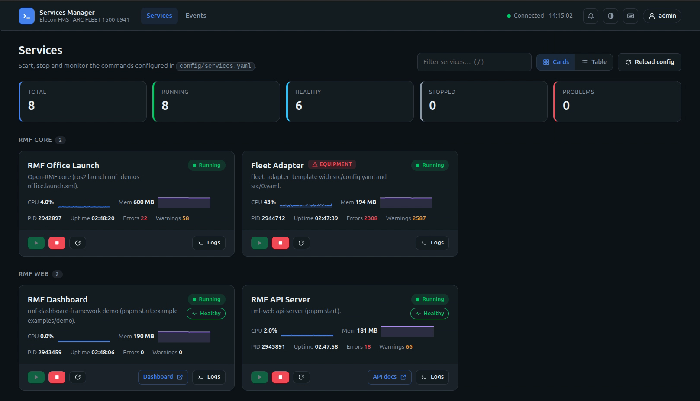
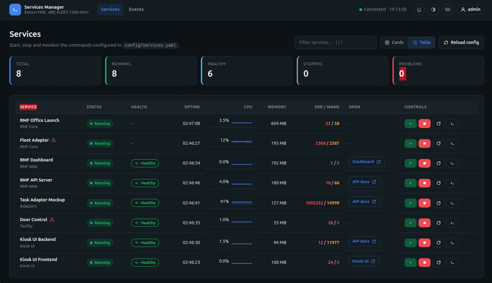

# Services Manager

**Elecon FMS — web control panel for the AMR / RMF software stack**

Services Manager lets you start, stop, restart and monitor the commands that make up the
Elecon FMS stack from one browser page instead of eight terminal windows. Each command's
terminal output is streamed live to the page, health and resource usage are tracked, every
action is recorded with the user who performed it, and alerts fire when something breaks.

All commands are declared in one YAML file, so adding a new one is a configuration change
with no code to write.

## Screenshots

**Card view:** services grouped by area, with live status, health, CPU and memory charts, error and warning counts, and Start / Stop / Restart controls. Equipment services are tagged so you notice them before acting.



**Table view:** all services in one table showing uptime, CPU, memory, error and warning counts, *Open* links to each service's web UI or API docs, and controls.



---

## Contents

1. [Features](#features)
2. [Managed services](#managed-services)
3. [Requirements](#requirements)
4. [Installation](#installation)
5. [Running](#running)
6. [User accounts and roles](#user-accounts-and-roles-13)
7. [Using the dashboard](#using-the-dashboard)
8. [Configuration](#configuration)
9. [Adding a new service](#adding-a-new-service)
10. [Project structure](#project-structure)
11. [Architecture](#architecture)
12. [REST API](#rest-api)
13. [Running as a system service](#running-as-a-system-service)
14. [Troubleshooting](#troubleshooting)
15. [Security](#security)

---

## Features

Items marked **#n** refer to the numbered feature list they were introduced with.

| # | Feature | Description |
|---|---|---|
| | **Process control** | Start, stop and restart from the browser. Stop sends Ctrl+C (SIGINT) to the whole process group, escalating to SIGTERM and SIGKILL until every child has exited. |
| | **Live console** | stdout/stderr streamed in real time (Server-Sent Events), with level filter, search and auto-scroll that pauses when you scroll up. |
| | **Terminal detection** | Notices when a command is already running from a terminal, shows it as *Running (outside manager)*, and refuses to start a second copy. |
| **#2** | **Health checks** | *Healthy / Starting… / Unhealthy*, based on an open TCP port, an HTTP endpoint, and/or "ready" and "broken" lines in the output. Shown on cards, in the table and on the service page, with every check's result. |
| **#3** | **Open buttons** | One-click links to each web service (dashboard, kiosk UI, API docs). URLs can be fixed, or read from the log (e.g. Vite's actual port), and use the host you opened the page with. |
| **#4** | **Reload config** | Re-reads `services.yaml` without restarting the manager. New services are added and removed ones stopped. Running services restart only if their command or environment changed. Invalid YAML is rejected and nothing changes. |
| **#5** | **Alerts** | When a service crashes or becomes unhealthy: in-page alert, optional sound, optional desktop notification, problem count in the browser tab title, and a red favicon. |
| **#7** | **CPU and memory** | Per service, including all child processes, read from `/proc`. Shown as live values and sparkline charts covering the last 2 minutes. |
| **#8** | **Event history** | Starts, stops, restarts, crashes, health changes, config reloads, sign-ins and failed sign-ins, each recorded with time and user. Includes an Events page with filters, a history panel per service, and a "crashes today" counter. Persisted to `logs/events.jsonl`. |
| **#9** | **Better console** | Keeps the programs' own colours (ROS log levels, Vite, pnpm). Jumps to the next/previous error, copies a line or the last 100 lines, switches between clock and "time ago" timestamps, toggles line wrap, and downloads the full log. |
| **#10** | **Table view** | Compact table (status, health, uptime, CPU, memory, errors, links, controls) as an alternative to cards. The choice is remembered per browser. |
| **#11** | **Keyboard shortcuts** | Navigation, service control and console navigation from the keyboard. Press **?** for the list. |
| **#12** | **Equipment confirmation** | Services marked `critical: true` (Fleet Adapter, Door Control) show an *Equipment* tag and ask for confirmation, with a safety warning, even to start. |
| **#13** | **Logins and roles** | The manager's own user accounts (not Linux/PC users), with hashed passwords and *viewer*, *operator* and *admin* roles. Every action records who did it. |
| **#14** | **UI polish** | Light/dark/auto theme switch, favicon that shows problems, loading placeholders, and a touch-friendly tablet layout. |

---

## Managed services

Configured in [`config/services.yaml`](config/services.yaml), listed in the usual
start-up order:

| # | Service | Group | Health check (#2) | Open (#3) | Critical (#12) |
|---|---|---|---|---|---|
| 1 | RMF Office Launch | RMF Core | – | – | |
| 2 | Fleet Adapter | RMF Core | – | – | ⚠ robots |
| 3 | RMF Dashboard | RMF Web | log: `ready in` | Dashboard | |
| 4 | RMF API Server | RMF Web | port 8000 | API docs | |
| 5 | Task Adapter Mockup | Adapters | port 5500 | API docs | |
| 6 | Door Control | Facility | log: `Connected to door PLC` / `Cannot connect…` | – | ⚠ door PLC |
| 7 | Kiosk UI Backend | Kiosk UI | port 8100 + HTTP `/docs` | API docs | |
| 8 | Kiosk UI Frontend | Kiosk UI | log: `ready in` | Kiosk UI | |

Commands and working directories:

| # | Working directory | Command |
|---|---|---|
| 1 | `~/rmf_ws_h6` | `ros2 launch rmf_demos office.launch.xml` |
| 2 | `~/fleet_adapter_template` | `ros2 run fleet_adapter_template fleet_adapter_template -c ./src/config.yaml -n ./src/0.yaml` |
| 3 | `~/rmf-web/packages/rmf-dashboard-framework` | `pnpm start:example examples/demo` |
| 4 | `~/rmf-web/packages/api-server` | `pnpm start` |
| 5 | `~/task_adapter_mockup` | `.venv/bin/python -m uvicorn main:app --host 0.0.0.0 --port 5500 --reload` |
| 6 | `~/amr-server/door-new` | `python3 door_control.py` |
| 7 | `~/Elecon_FMS/Elecon_UI/Elecon-kiosk-ui/backend` | `.venv/bin/python -m uvicorn app.api.main:app --host 0.0.0.0 --port 8100 --reload` |
| 8 | `~/Elecon_FMS/Elecon_UI/Elecon-kiosk-ui/frontend` | `npm run dev` |

---

## Requirements

- Ubuntu 24.04 with Python 3.12
- `bash`, and `pgrep` (from `procps`) for terminal detection
- ROS 2 Jazzy at `/opt/ros/jazzy` and the RMF workspace at `~/rmf_ws_h6`
- Node.js via **nvm** (`~/.nvm`) and **pnpm** (`~/.local/share/pnpm`) for the web services

Python dependencies (see [`requirements.txt`](requirements.txt)): Flask ≥ 3.0, PyYAML ≥ 6.0.
CPU/memory (#7) and health checks (#2) use only the standard library.

---

## Installation

```bash
cd ~/Elecon_FMS/Services_Manager
python3 -m venv .venv
.venv/bin/pip install -r requirements.txt
.venv/bin/python manage.py add-user admin --role admin     # first account (#13)
```

The virtual environment is used **only by the manager itself**. Managed commands are
started with this venv removed from their environment, so they use the system `python3`
and its packages (`rclpy`, `pymodbus`, ...) exactly as in a terminal.

---

## Running

```bash
cd ~/Elecon_FMS/Services_Manager
.venv/bin/python run.py
```

Open **http://localhost:5000**, or **http://&lt;server-ip&gt;:5000** from another machine,
and sign in.

| Variable | Default | Purpose |
|---|---|---|
| `SM_HOST` | `0.0.0.0` | Interface to listen on (`127.0.0.1` = this machine only) |
| `SM_PORT` | `5000` | HTTP port |
| `SM_SERVICES_FILE` | `config/services.yaml` | Path to the service registry |
| `SM_SECRET_KEY` | generated in `instance/secret_key` | Key that signs login sessions |
| `SM_LOG_LEVEL` | `INFO` | Log level of the manager itself |

Press **Ctrl+C** to stop the manager. This also stops every service it started.

---

## User accounts and roles (#13)

Accounts belong to the Services Manager only. They aren't Linux/PC accounts. They are
stored in `config/users.yaml` (permissions `600`, passwords hashed) and managed from the
command line:

```bash
.venv/bin/python manage.py list-users
.venv/bin/python manage.py add-user ravi --role operator     # prompts for a password
.venv/bin/python manage.py passwd admin                      # change a password
.venv/bin/python manage.py set-role ravi viewer
.venv/bin/python manage.py del-user ravi
```

| Role | Can |
|---|---|
| `viewer` | See the dashboard, consoles, health, resources and events. Download logs. |
| `operator` | Everything a viewer can, plus start / stop / restart, run actions, and clear consoles. |
| `admin` | Everything an operator can, plus **Reload config** (#4). |

- Changes to `users.yaml` take effect immediately; no restart needed.
- Sessions last `session_hours` (default 12).
- Failed sign-ins are slowed down and recorded in the event history (#8).
- `manage.py` refuses to delete or demote the last admin.
- To turn logins off (e.g. on an isolated test bench), set `settings.auth.enabled: false`.
  Everyone then has full access.

---

## Using the dashboard

### Services page (`/`)

- **Summary tiles:** Total, Running, Healthy, Stopped, Problems. Click a tile to filter.
- **Cards or Table (#10):** switch with the buttons or **v**.
- **Each service shows:**
  - status and health (#2)
  - CPU and memory with charts (#7)
  - errors / warnings and crashes today (#8)
  - *Open* links (#3)
  - Start / Stop / Restart
- **Reload config (#4):** admin only.

### Service page (`/services/<id>`)

- **Health panel (#2):** the result of each check, and since when.
- **Resources (#7):** CPU and memory now, a chart, and the process count.
- **History (#8):** the last events for this service.
- **Console (#9):**
  - level filter and search
  - **↑ / ↓** to jump between errors
  - **⏱** to switch timestamp style
  - copy a line (hover) or the last 100 lines
  - wrap toggle, download, clear

### Events page (`/events`) (#8)

Every recorded event, filterable by service and level, with search.

### Alerts (#5)

Set them in the **bell** menu:
- **Sound:** a short chime when a service crashes or becomes unhealthy.
- **Desktop notification:** needs the page opened via `https://` or `localhost`. Over plain
  `http://<ip>` the browser blocks it, but in-page alerts, the sound, the tab title and the
  favicon still work.

### Status and health meanings

| Status | Meaning |
|---|---|
| Running | Started by the manager and alive |
| Running (outside manager) | Same program detected running from a terminal |
| Starting / Stopping | Transition in progress |
| Stopped | Stopped by a user |
| Exited (code 0) | Ended by itself normally |
| Failed (code N) | Ended by itself with an error, or could not be started |

| Health (#2) | Meaning |
|---|---|
| Healthy | Every configured check passes |
| Starting… | Checks not passing yet, still within `grace` seconds after start |
| Unhealthy | A check fails after the grace period (port closed, HTTP error, "broken" log line) |
| Health unknown | Running from a terminal and only log checks are configured (output not visible) |

### Keyboard shortcuts (#11)

Press **?** on any page for the full list.

| Keys | Action |
|---|---|
| `?` | Show shortcuts |
| `g` then `s` / `g` then `e` | Go to Services / Events |
| `T` | Switch theme (auto → light → dark) |
| `/` | Focus search |
| `v` | Cards ↔ table (Services page) |
| `Esc` | Clear filters / leave a text box |
| `s` / `x` / `r` | Start / stop / restart (service page) |
| `e` / `E` | Next / previous error in the console |
| `t` | Clock ↔ "time ago" timestamps |
| `f` | Follow output (jump to latest) |
| `w` | Toggle line wrap |

---

## Configuration

Everything lives in [`config/services.yaml`](config/services.yaml). After editing it,
click **Reload config** (#4) on the dashboard. Only the services you changed are affected.

### `settings`

| Key | Default | Description |
|---|---|---|
| `log_dir` | `logs` | Folder for per-service logs and `events.jsonl` |
| `log_buffer_lines` | `3000` | Lines kept in memory per service for the web console |
| `log_file_max_mb` / `log_file_backups` | `5` / `3` | Log file rotation |
| `metrics_interval` | `2` | Seconds between CPU/memory samples (#7) |
| `auth.enabled` | `false` | Require sign-in (#13). This installation sets it to `true`. |
| `auth.users_file` | `users.yaml` | Account file, relative to `config/` |
| `auth.session_hours` | `12` | How long a sign-in lasts |

### `profiles`

Commands are started by a non-interactive `bash`, which does **not** read `~/.bashrc`.
Anything the terminal gets from `.bashrc` must be loaded through a profile.

| Profile | Loads |
|---|---|
| `ros2` | `/opt/ros/jazzy/setup.bash`, `~/rmf_ws_h6/install/setup.bash`, [`config/env/pythonpath.sh`](config/env/pythonpath.sh), and coloured ROS log output (#9) |
| `node` | `~/.nvm/nvm.sh`, [`config/env/pnpm.sh`](config/env/pnpm.sh), and coloured npm/Vite output (#9) |

Relative `source` paths in a profile are relative to the `config/` folder.

### `services`

| Key | Default | Description |
|---|---|---|
| `id` | *required* | Unique id (`a-z 0-9 _ -`), used in URLs and log file names |
| `name` | `id` | Display name |
| `description`, `group` | | Card text and dashboard group heading |
| `profile` | | One profile name, or a list (e.g. `[ros2, node]`) |
| `cwd` | | Working directory (`~` expanded) |
| `source` | | Extra script(s) to source, relative to `cwd` |
| `env` | | Extra environment variables |
| `command` | *required* | The command, exactly as typed in a terminal |
| `autostart` | `false` | Start when the manager starts |
| `restart_on_failure`, `max_restarts`, `restart_delay` | `false`, `3`, `5` | Automatic restart after a crash |
| `stop_timeout` | `10` | Seconds to wait after Ctrl+C before escalating |
| `detect_external` | | Regex matched with `pgrep -f` to detect a copy started from a terminal |
| `critical` | `false` | **#12** Equipment tag and extra confirmation |
| `health` | | **#2** see below |
| `links` | | **#3** see below |
| `actions`, `monitors` | | One-shot command buttons and live values parsed from a command's output |

**`health` (#2).** At least one check is required.

| Key | Default | Description |
|---|---|---|
| `port` | | TCP port that must accept connections |
| `host` | `127.0.0.1` | Host for the port check |
| `http` | | URL that must answer with HTTP status < 400 |
| `log_ready` | | Regex for an output line meaning "ready" |
| `log_unhealthy` | | Regex for an output line meaning "broken". The latest match of the two wins. |
| `grace` | `60` | Seconds after start before failing checks count as *Unhealthy* |
| `interval` / `timeout` | `5` / `2` | Check frequency and network timeout (seconds) |

**`links` (#3):** a list of `{label, url, from_log}`.
- `url` may contain `{host}`, which becomes the host you opened the page with.
- `from_log` is a regex whose first group captures a URL from the output, e.g.
  `'Local:\s+(https?://\S+)'` for Vite. `localhost` in captured URLs is replaced with the
  page's host.

---

## Adding a new service

1. Add a block under `services:` in `config/services.yaml`:

   ```yaml
     - id: lifter_control
       name: Lifter Control
       description: ROS 2 node for the lifter PLC.
       group: Facility
       profile: ros2
       cwd: ~/amr-server/lifter
       command: python3 lifter_control.py
       stop_timeout: 10
       detect_external: 'python3? .*lifter_control\.py'
       critical: true                                   # (#12)
       health:                                          # (#2)
         log_ready: 'Connected to lifter PLC'
         log_unhealthy: 'Cannot connect'
         grace: 30
       links:                                           # (#3)
         - label: Lifter UI
           url: 'http://{host}:8200/'
   ```

2. Click **Reload config** (#4). If the file is invalid, the error is shown and nothing
   changes. To check it from the command line instead:

   ```bash
   .venv/bin/python -c "from pathlib import Path; from app.core.registry import load_config; \
   print([s.id for s in load_config('config/services.yaml', Path('.'))[1]])"
   ```

The card, table row, detail page, console, health, resources and history are generated
automatically, with no Python, HTML or JavaScript changes.

**Tips**
- Use the command exactly as it works in a terminal. If it needs something from
  `~/.bashrc`, add it to a profile or to a script in `config/env/`.
- Check a `detect_external` pattern with `pgrep -af '<pattern>'` while the program runs
  from a terminal.
- For `log_ready`, pick a line the program prints once it is fully up.

---

## Project structure

```
Services_Manager/
├── run.py                        # Entry point
├── manage.py                     # User account CLI (#13)
├── requirements.txt
├── config/
│   ├── services.yaml             # Service registry
│   ├── users.yaml                # Accounts, hashed passwords (#13), not in git
│   └── env/                      # pnpm.sh, pythonpath.sh (from ~/.bashrc)
├── app/
│   ├── __init__.py               # App factory, signal handling, shutdown
│   ├── config.py                 # Settings and environment overrides
│   ├── auth.py                   # Sessions, roles, CSRF guard (#13)
│   ├── core/                     # Process engine, independent of Flask
│   │   ├── registry.py           # YAML → validated dataclasses
│   │   ├── process.py            # Spawn, stream, graceful group stop
│   │   ├── logbuffer.py          # Ring buffer, level + colour handling (#9)
│   │   ├── service.py            # Lifecycle, reload (#4), detection, status
│   │   ├── health.py             # Port / HTTP / log checks (#2)
│   │   ├── metrics.py            # CPU and memory from /proc (#7)
│   │   ├── events.py             # Event history (#8)
│   │   ├── action.py, monitor.py # Buttons and live values
│   │   └── manager.py            # All services, supervisor thread, reload (#4)
│   ├── api/routes.py             # JSON REST API and SSE log stream
│   ├── web/routes.py             # Pages, sign-in, sign-out
│   ├── templates/                # base, login, dashboard, service, events
│   └── static/
│       ├── css/style.css         # Themes (#14), table (#10), console (#9)
│       └── js/                   # common, dashboard, service, events
├── deploy/services-manager.service
├── instance/secret_key           # Session signing key (generated), not in git
└── logs/                         # <service-id>.log, events.jsonl, server.out
```

---

## Architecture

```
 Browser ──JSON poll (2 s), SSE log stream──▶ auth.py (session, role, CSRF)
                                                   │
                                          api/routes.py, web/routes.py
                                                   │
                                          core/manager.py ── supervisor thread
                                                   │             ├─ metrics.py (#7)
                                                   │             └─ health.py  (#2)
                                          core/service.py ── events.py (#8)
                                                   │
                                          core/process.py
                                                   │ bash -c "source …; <command>"
                                                   │ own process group / session
                                                   ▼
                                          managed process ── output ──▶ logbuffer.py
                                                                         ├─ console (memory)
                                                                         └─ logs/<id>.log
```

- Each command runs in its **own session and process group**, so Stop reaches every child,
  and CPU/memory (#7) include all of them.
- One supervisor thread samples `/proc` every `metrics_interval` and runs health checks
  (#2) in a small thread pool.
- All browser pages share one poll of `/api/services`. Alerts (#5) are computed from it on
  every page.
- `core/` has no Flask dependency.
- The manager holds process state in memory, so it must run as a **single process**
  (no reloader, no multiple workers).

---

## REST API

All endpoints need a signed-in session when `auth.enabled` is on. `POST` requests must
send the header `X-Requested-With: ServicesManager` (CSRF protection).

| Method | Endpoint | Role | Description |
|---|---|---|---|
| `GET` | `/api/me` | viewer | Current user |
| `GET` | `/api/services` | viewer | Status of all services, incl. health, metrics and links |
| `GET` | `/api/services/<id>` | viewer | Status of one service |
| `POST` | `/api/services/<id>/start` \| `stop` \| `restart` | operator | Lifecycle (stop also handles copies started from a terminal) |
| `POST` | `/api/services/<id>/actions/<action_id>` | operator | Run an action |
| `POST` | `/api/config/reload` | admin | Reload `services.yaml` (#4) |
| `GET` | `/api/events?service=&level=&kind=&limit=` | viewer | Event history (#8) |
| `GET` | `/api/services/<id>/logs?since=<seq>&limit=<n>` | viewer | Log lines |
| `GET` | `/api/services/<id>/logs/stream` | viewer | Live log stream (SSE) |
| `POST` | `/api/services/<id>/logs/clear` | operator | Clear the in-memory console |
| `GET` | `/api/services/<id>/logs/download` | viewer | Download the log file |

Example from a script:

```bash
curl -c jar -d 'username=admin&password=…' http://localhost:5000/login
curl -b jar -H 'X-Requested-With: ServicesManager' -X POST \
     http://localhost:5000/api/services/door_control/start
```

---

## Running as a system service

```bash
sudo cp deploy/services-manager.service /etc/systemd/system/
sudo systemctl daemon-reload
sudo systemctl enable --now services-manager
journalctl -u services-manager -f
```

The unit runs the manager from `.venv` as user `amr-wipro`. If a managed service opens
windows (Gazebo or RViz from the RMF launch), uncomment the `DISPLAY` and `XAUTHORITY`
lines in the unit file first.

---

## Troubleshooting

| Symptom | Cause | Fix |
|---|---|---|
| Forgot a password | | `.venv/bin/python manage.py passwd <name>` |
| Login page says "No user accounts exist" | `config/users.yaml` is missing or empty | `.venv/bin/python manage.py add-user admin --role admin` |
| Buttons are greyed out with "Requires the operator role" | Account is a viewer | `manage.py set-role <name> operator` |
| `ModuleNotFoundError` (e.g. `pymodbus`, `rclpy`) | Command isn't getting the terminal's Python environment | Use the `ros2` profile. Managed commands already run without the manager's venv. |
| `npm` / `pnpm: command not found` | nvm and pnpm are only set up in `~/.bashrc` | Add `profile: node` (or `[ros2, node]`) |
| `Environment script not found` | Wrong `source` path | Profile paths are relative to `config/`; service paths are relative to `cwd` |
| Stuck on *Starting…* then *Unhealthy* | Port/URL wrong, or the `log_ready` text never appears | Open the service page's Health panel to see which check fails; adjust `health` and Reload config |
| *Running (outside manager)* | Started from a terminal | **Stop external**, then **Start** |
| No desktop notifications | Page opened over plain `http://<ip>` | Use `localhost` or HTTPS; sound and in-page alerts still work |
| Reload config shows an error | Invalid YAML or field | Fix the reported line; nothing was changed |
| Port 5000 already in use | Another manager instance is running | `ss -ltnp \| grep :5000`, or start with `SM_PORT=5001` |

Manager logs are in `logs/server.out` when started in the background, or in
`journalctl -u services-manager` under systemd.

---

## Security

- **Sign-in is required** (#13). Passwords are hashed (Werkzeug `scrypt`), sessions are
  signed with `instance/secret_key`, and cookies are `HttpOnly` / `SameSite=Lax`.
- **Roles are enforced on the server.** Hiding buttons in the browser is only for
  convenience.
- **State-changing API calls need a custom header**, so another website can't trigger
  start/stop through a logged-in browser.
- **Only commands defined in `services.yaml` can run.** The browser cannot send arbitrary
  commands.
- **The connection is plain HTTP.** Passwords cross the network unencrypted. For use
  beyond the plant network, put the manager behind a reverse proxy (e.g. nginx) with TLS,
  or bind it to localhost with `SM_HOST=127.0.0.1`.
- Keep `config/users.yaml` and `instance/secret_key` private. Both are excluded from git.
